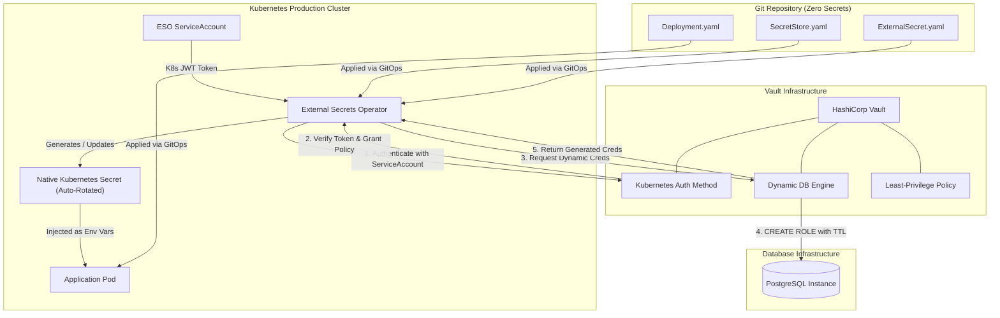

# Zero-Secrets GitOps: Dynamic Secrets Management with HashiCorp Vault & External Secrets Operator

<p align="center">
  
</p>

[](https://kubernetes.io/)
[](https://www.vaultproject.io/)
[](https://external-secrets.io/)
[](#)
[](LICENSE)

An enterprise-grade, cloud-native secret management reference architecture that achieves **Zero Secrets in Git**. Instead of committing static Base64 secrets or managing encrypted blobs in version control, this platform leverages **HashiCorp Vault's Dynamic Database Secrets Engine** to mint on-demand, short-lived PostgreSQL database credentials, synchronized directly into Kubernetes pods via the **External Secrets Operator (ESO)**.

---

## 🌟 Why This Architecture?

In conventional GitOps workflows (even with Sealed Secrets or SOPS), organizations encounter severe vulnerabilities:
1. **Static Credentials:** Passwords sit unchanged in database user tables for months.
2. **Audit & Rotation Nightmares:** When a credential leaks, hundreds of Kubernetes deployments across multiple clusters require manual rotation.
3. **Compromised Blast Radius:** A compromised application container exposes long-lived database access.

### The Solution:
- **Zero Secrets in Git:** Git manifests only hold reference pointers (path lookups), never cryptographic keys or secrets.
- **Dynamic Credential Minting:** Vault creates a unique PostgreSQL user for each lease with strict TTLs (e.g. 1 hour).
- **Auto-Revocation & Leases:** When a pod terminates or the lease expires, Vault automatically drops or revokes the database role.
- **Native K8s Secret Consumption:** Developers write standard Kubernetes deployments consuming native `Secret` environment variables without requiring intrusive Vault SDKs or sidecars.

---

## 🏗️ Architecture & Workflow



---

## 🚀 Quickstart & One-Command Demo

### Prerequisites
- Kubernetes cluster (Kind, Minikube, or EKS/GKE/AKS)
- `kubectl` and `helm` v3+ installed

### 1. Automated Setup
Run the setup script to install PostgreSQL, HashiCorp Vault, and the External Secrets Operator:
```bash
make setup-vault
```

### 2. Deploy Application & Secret Resources
Apply the `SecretStore`, `ExternalSecret`, and the consumer microservice:
```bash
make deploy-app
```

### 3. Verify Dynamic Credential Minting
Run the automated verification suite:
```bash
make verify
```

Expected output:
```text
>> 1. Checking ExternalSecret Status...
NAME                     STORE           REFRESH-INTERVAL   STATUS         READY
postgres-dynamic-creds   vault-backend   15m                SecretSynced   True

>> 2. Inspecting Generated Kubernetes Secret...
  [SUCCESS] Dynamically Generated DB Username: v-token-webapp-ro-2938472918...
  [VERIFIED] User is dynamically provisioned by HashiCorp Vault!

>> 3. Checking Consumer Pod Logs...
Dynamic Credential Active -> DB_USER=v-token-webapp-ro-2938472918...

>> 4. Zero Secrets in Git Check...
  [VERIFIED] Zero database passwords found in application or GitOps manifests!
```

---

## 🔒 Security Model & Best Practices

| Control | Implementation |
| :--- | :--- |
| **Authentication** | Kubernetes ServiceAccount JWT verification via Vault `/v1/auth/kubernetes`. |
| **Least Privilege Policy** | Bounded path `/database/creds/webapp-role` with `read` capability only. |
| **Credential Lifetime** | Default TTL of 1 hour, hard maximum TTL of 24 hours. |
| **Separation of Duties** | DevOps/Platform teams configure `SecretStore`; Dev teams declare `ExternalSecret` needs. |
| **Supply Chain Cleanliness** | Gitleaks / TruffleHog CI checks pass with 0 warnings. |

---

## 📂 Repository Structure

```text
vault-secrets-operator-k8s/
├── Makefile                          # Complete build & test lifecycle targets
├── README.md                         # Architecture & quickstart guide
├── LICENSE                           # MIT License
├── k8s/
│   ├── app/
│   │   └── deployment.yaml           # Consumer application pod manifest
│   ├── external-secrets/
│   │   ├── secret-store.yaml         # Connection from ESO to Vault
│   │   └── external-secret.yaml      # Definition of secrets to synchronize
│   ├── postgres/
│   │   └── postgres.yaml             # Target database deployment & service
│   └── vault/
│       ├── vault-policy.hcl          # Least-privilege ACL policy
│       └── vault-values.yaml         # Helm configuration values
├── docs/
│   ├── ARCHITECTURE.md               # In-depth architectural trade-off analysis
│   └── INTERVIEW_TALKING_POINTS.md   # SRE / DevOps interview talking points
└── scripts/
    ├── setup-vault.sh                # End-to-end automation bootstrap script
    └── verify-zero-secrets.sh        # Verification and GitLeaks audit script
```

---

## 👤 Author & Contact
- **Engineer:** Rahul Motvani (DevOps / SRE / DevSecOps)
- **LinkedIn:** [linkedin.com/in/rahulmotvani](https://www.linkedin.com/in/rahulmotvani/)
- **GitHub:** [github.com/rahulmotvani0-sketch](https://github.com/rahulmotvani0-sketch)
